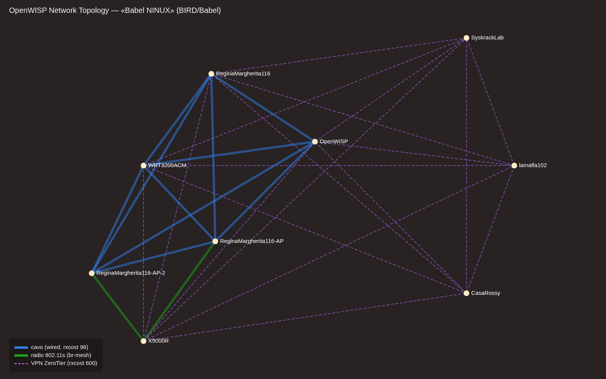

[🇬🇧 English](README.en.md) | 🇮🇹 Italiano

# OpenWISP2 full + ZeroTier + WiFi Login Pages

> 📖 Questo repository fa parte dell'infrastruttura di **NINUX Basilicata**: la guida per ricostruirla tutta, passo passo (Proxmox, DNS, OpenWISP, moduli, firmware, app), è su **[docs.ninux-nnxx.it](https://docs.ninux-nnxx.it)**.

Playbook Ansible che installa su un CT (Debian 13 / Ubuntu 22.04+):

- **OpenWISP2 full**: controller, monitoring, network topology, firmware upgrader, RADIUS
- **WiFi Login Pages** (captive portal)
- **Controller ZeroTier self-hosted** sulla stessa CT, gestito da OpenWISP

Il certificato SSL **non** viene gestito dal playbook: lo carichi tu manualmente sul CT (vedi sotto).

## Prerequisiti

- CT con Debian 13 o Ubuntu 22.04/24.04, accesso SSH come root (o utente sudo)
- Ansible ≥ 2.13 sulla macchina da cui lanci il playbook
- **Se il CT è un LXC su Proxmox**: ZeroTier usa `/dev/net/tun`, che va esposto
  nel container *unprivileged*:

  ```
  # /etc/pve/lxc/<ID>.conf
  lxc.cgroup2.devices.allow: c 10:200 rwm
  lxc.mount.entry: /dev/net/tun dev/net/tun none bind,create=file
  ```

## 1. Installazione ruoli e configurazione

Ruoli e collections sono installati **dentro il repo** (`roles/` e
`collections/`, vedi `ansible.cfg`) dalle release GitHub più recenti.
Per (re)installarli o aggiornarli:

```bash
ansible-galaxy role install -r requirements.yml -p roles/ --force
ansible-galaxy collection install -r requirements.yml -p collections/ --force
```

Poi modifica:

- `hosts` → **il nome host dell'inventario È il dominio di OpenWISP**
  (il ruolo lo usa per nginx e Django): sostituisci `openwisp.example.com`
  con il tuo dominio reale e `ansible_host` con l'IP del CT
- `playbook.yml` → `wifi_login_pages_domains`, email
- `owlp_organizations/` → configurazione delle organizzazioni per le login pages
- `secrets.yml` → copia da `secrets.example.yml` e metti il secret RADIUS

## 2. Esecuzione (OpenWISP + ZeroTier + WiFi Login Pages)

```bash
ansible-playbook -i hosts playbook.yml
```

Il playbook installa in sequenza: OpenWISP + WiFi Login Pages (Play 1), il
controller ZeroTier (Play 2), il firewall nftables (Play 3), bird2/Babel (Play 4).

Al termine vai su `https://<tuo-dominio>/admin`: il ruolo crea l'utente
**admin / admin** — cambia subito la password da
`https://<tuo-dominio>/admin/password_change/`.

> **Prima installazione — nota su freeradius**: su un CT nuovo l'handler
> "Restart freeradius" del ruolo può scattare prima che nginx serva su 443.
> `rlm_rest` apre un pool verso `https://<dominio>/api/v1/freeradius` e, se
> nginx non risponde ancora, freeradius non parte e il play si ferma. Se
> capita: `systemctl restart nginx && systemctl restart freeradius`, poi
> rilancia il playbook (le parti già fatte sono idempotenti).

## 3. Certificato SSL manuale

Il playbook punta al certificato già presente sul CT:

- `/etc/ssl/acme/ninux-nnxx.it.fullchain.pem`
- `/etc/ssl/acme/ninux-nnxx.it.key`

Il ruolo genera un self-signed **solo se i file non esistono**, quindi non li
toccherà mai: li rinnovi tu in autonomia (dopo il rinnovo:
`systemctl reload nginx`).

> Il certificato deve coprire sia `openwisp.ninux-nnxx.it` sia
> `wifi.ninux-nnxx.it` (wildcard `*.ninux-nnxx.it` o SAN). Verifica con:
> `openssl x509 -in /etc/ssl/acme/ninux-nnxx.it.fullchain.pem -noout -text | grep DNS`

## 4. VPN ZeroTier

**Design**: la VPN serve solo a far vedere i router tra loro e a scambiare le
rotte via Babel — **ogni router mantiene il proprio gateway e OpenWISP NON fa
da gateway** (nessun NAT, nessuna default route via tunnel).

Si usa **ZeroTier** con **controller self-hosted sulla stessa CT**: ZeroTier
fornisce una L2 su cui Babel scopre i vicini via multicast, come nel design
storico NINUX. L'interfaccia sui router torna a chiamarsi `owzt<6hex del
network id>` e su di essa gira Babel.

### 4a. Controller ZeroTier (Play 2)

Il Play 2 (`--tags zerotier`) installa `zerotier-one` sulla CT (script ufficiale
firmato) e avvia il servizio. Il nodo diventa il controller della rete che
OpenWISP creerà. A fine play vengono stampati il **node address** e il percorso
del token API.

### 4b. Crea la VPN in OpenWISP

Admin → **VPN servers** → Add:

- Backend: **ZeroTier**
- Host: `127.0.0.1:9993` (il controller gira sulla stessa CT di OpenWISP;
  l'API ZeroTier ascolta in locale su 9993)
- AuthToken: il contenuto di `/var/lib/zerotier-one/authtoken.secret` sul CT
  (`sudo cat /var/lib/zerotier-one/authtoken.secret`)
- Subnet: `10.27.255.0/24` (la stessa di `bird_vpn_subnet_v4` /
  `firewall_radius_sources_v4` nei play) — è la rete gestita ZeroTier

Salvando, OpenWISP rileva il node address del controller e **crea la rete
ZeroTier**, di cui gestisce membri e indirizzi.

> Il nome pubblico `zerotier.ninux-nnxx.it` (CNAME di openwisp) è solo un
> riferimento DNS: per l'oggetto VPN si usa comunque `127.0.0.1:9993`, perché
> OpenWISP parla all'API locale del controller.

### 4c. Template client

In Admin → **Templates** → Add:

- Type: **VPN-client**
- VPN: la VPN ZeroTier creata sopra
- Automatic tunnel provisioning: **attivo** (OpenWISP genera per ogni device
  `zerotier_member_id`, `identity_secret` e l'IP interno, e lo autorizza sulla rete)

Sul router l'interfaccia risultante è `owzt<id>`: è quella su cui Babel aggancia
le adiacenze (già configurato nel template bird come `owzt*`). Il resto della
config dei router (kernel/direct/babel/OSPF per la default via `br-mesh`) resta
identico.

> **Router senza internet propria**: funzionano senza modifiche. La default la
> imparano dalla mesh vicina via OSPF su `br-mesh`, e ZeroTier raggiunge i peer
> uscendo dal gateway del momento (UDP 9993, segue la rotta di default). I filtri
> Babel garantiscono che la default non arrivi mai dalla VPN.

## 4d. Firewall

Il play `firewall` (nftables) applica una policy **default drop** in ingresso.
Niente NAT: OpenWISP non fa da gateway; il forward è permesso **solo**
`zt* → zt*` (traffico router↔router attraverso l'hub; sul server l'interfaccia
ZeroTier è `zt<id>`, sui router `owzt<id>`).

Interfacce del CT: **ens18** = rete di gestione (10.27.22.18, 2a07:7e81:3f1c::18),
**ens19** = IP pubblico (194.28.98.61/29), **zt<id>** = VPN ZeroTier (10.27.255.1).

| Porta | Proto | Da | Servizio |
|-------|-------|-----|----------|
| 2400  | TCP   | solo rete di gestione (`10.27.0.0/16`) | SSH |
| 80, 443 | TCP | ovunque | nginx (OpenWISP + WiFi Login Pages) |
| 9993  | UDP   | ovunque | ZeroTier (controller + data plane) |
| 1812–1813 | UDP | solo VPN (10.27.255.0/24) e gestione (10.27.0.0/16) | FreeRADIUS |
| 6696  | UDP   | solo interfacce `zt*`, `ens18` e `ens19` | Babel (bird2) |

Il play si applica anche da solo con `--tags firewall`.

<a id="babel"></a>
## 4e. BIRD / Babel (rete NINUX)

Il routing tra i nodi NINUX lo fa **Babel** (RFC 8966), un protocollo
distance-vector pensato per le reti miste radio e cavo. Nelle reti comunitarie
fa lo stesso lavoro di OLSR o batman-adv. Lo implementa **BIRD**: `bird2` di
Debian (2.17) sul server, **BIRD 3** (3.3.x) sui router con il firmware NINUX
su OpenWrt 25.12. La configurazione Babel è la stessa nelle due versioni.



*La topology «Babel NINUX» del 21/10/2026, disegnata con netjsongraph.js, la
stessa libreria del visualizzatore di OpenWISP, e con i suoi colori. Sono
mostrati solo i link attivi. A sinistra la sede di ReginaMargherita116 (cavo e
radio), a destra i siti remoti, raggiunti solo via VPN.*

### Collegamenti e rxcost

Ogni nodo annuncia la propria LAN (`br-lan`, una /24 per nodo) e impara quelle
degli altri. Babel sceglie il percorso con la metrica totale più bassa, e gli
`rxcost` sono fissati in modo che **il cavo vinca sempre sulla radio e la radio sulla
VPN**:

| Collegamento | Interfaccia (router / server) | Tipo Babel | `rxcost` |
|---|---|---|---|
| Cavo (stessa LAN) | `br-lan`, e `wan` dove serve / `ens18`, `ens19` | `wired` | 96 |
| Radio 802.11s (mesh cifrata SAE) | `br-mesh` / – | `wireless` | 256 e oltre, in base alla qualità del link |
| VPN ZeroTier | `owzt*` / `zt*` | default | 600 |

Regole comuni a tutti i nodi:

- la **default route non passa mai da Babel**, né annunciata né importata
  (filtri `net != 0.0.0.0/0` e `net != ::/0`): ogni nodo tiene il proprio
  gateway verso Internet;
- i nodi senza una connessione propria imparano la default dai vicini della
  mesh via **OSPF**, solo su `br-mesh`, con BFD per accorgersi in fretta della
  caduta di un link radio;
- `check link yes`: un'interfaccia senza link (o che non esiste ancora, come
  la VPN prima del join) viene ignorata, e la si può configurare in anticipo.

### Server (Play 4)

Il play `bird` (tag omonimo) installa **bird2** e applica
`templates/bird.conf.j2`. La configurazione viene validata con `bird -p` prima
di essere applicata.

| Variabile | Valore | Uso |
|---|---|---|
| `bird_wan_interface` | `ens19` | da qui si ricava il router id |
| `bird_vpn_interface` | `zt*` | VPN ZeroTier: Babel con `rxcost 600` |
| `bird_vpn_subnet_v4` | `10.27.255.0/24` | subnet ZeroTier, annunciata come rete connessa |
| `bird_direct_extra_interfaces` | `ens18` | anche la LAN di gestione è annunciata come connessa |
| `bird_babel_interfaces` | `zt*`, `ens19`, `ens18` | interfacce su cui il server parla Babel |

- il protocollo **direct `vpn`** annuncia la subnet ZeroTier e la LAN di
  gestione. Originarle sul server le fa arrivare ai router con metrica ~0:
  i router remoti tornano dal server, invece che da un nodo di test con la WAN
  sulla stessa LAN;
- `kernel4`/`kernel6` con `scan time 20`, `learn yes`, `merge paths yes` e
  `import` chiuso: il server ha già la sua default e non importa nulla dal
  kernel;
- il firewall (Play 3) accetta Babel (UDP 6696) solo su `zt*`, `ens18` ed
  `ens19`.

> NB: l'interfaccia `zt*` del server esiste solo dopo che la VPN è stata creata
> in OpenWISP e il CT ha fatto il join alla rete ZeroTier; con `check link yes`
> bird la ignora finché non compare, quindi il play si può lanciare anche prima.

### Router (template «Bird2 Babel (routing)»)

Sui router la configurazione arriva da OpenWISP con il template **Bird2 Babel
(routing)** (default e obbligatorio). Il sorgente è
`openwisp-templates/router-files/bird.conf`; il JSON del template si rigenera
con `openwisp-templates/build_bird_template.py`, che include anche
`post-reload-hook`. openwisp-config lo esegue dopo ogni applicazione della
configurazione: crea le zone firewall «VPN» (`owzt*`) e «mesh» (`br-mesh`),
senza le quali la policy REJECT in ingresso blocca Babel (adiacenza a senso
unico, metrica infinita), poi installa o ricarica bird.

- `protocol direct lan`: annuncia la LAN del nodo (`br-lan`);
- `protocol babel ninux`: interfacce `owzt*` (VPN, `rxcost 600`), `br-lan` (cavo, `rxcost 96`),
  `br-mesh` (radio) e `{{ babel_wired_extra }}`;
- `babel_wired_extra` serve ai nodi che hanno l'uplink via cavo su
  un'interfaccia diversa da `br-lan`. I router collegati alla LAN di
  ReginaMargherita116 dalla porta `wan` (WRT3200ACM, C2600, X5000R) hanno il
  template **Uplink LAN su wan** (`openwisp-templates/uplink-lan-wan.json`): la
  imposta a `wan`, apre Babel e SSH dalla LAN nella zona `wan` e mette l'agente
  in gestione sulla `wan`. Il default `none-babel` non corrisponde a nessuna
  interfaccia, quindi altrove il blocco non fa nulla. Non usarla sulla `wan` dei
  siti remoti, che lì è il modem del provider;
- `protocol ospf v3 internet_v4`: solo per la default via `br-mesh`;
  `wan_interface` (default `wan`, dai `default_values` del template) è lo stub
  da cui un nodo con Internet propria la annuncia.

**Il firmware deve restare allineato**: i file statici di bird nel repo
[ansible-ninux-openwrt](https://github.com/mikysal78/ansible-ninux-openwrt)
vanno aggiornati se qui cambiano interfacce o template.

### Verifica

Sul server (`ssh -p 2400 root@10.27.22.18`) o su un router:

```bash
birdc show babel interfaces     # interfacce Babel, rxcost, numero di vicini
birdc show babel neighbors      # vicini (fe80::), metrica, interfaccia
birdc show route protocol ninux # rotte imparate via Babel
birdc show route for 10.27.1.0/24 all   # da dove passa una LAN
```

Un vicino che compare in `show babel neighbors` con metrica stabile è un link
attivo; `Routes 0` indica un vicino visto ma da cui non si impara nulla.

### Topology Babel in Network Topology

netdiff, la libreria che OpenWISP Network Topology usa per leggere le
topologie, ha parser per OLSR, batman-adv, BMX6, OpenVPN, WireGuard e
ZeroTier, ma **non per Babel**. In più Babel è distance-vector: ogni nodo
conosce solo i propri vicini, quindi la topologia intera si ottiene solo
unendo quello che vedono tutti. Ne abbiamo discusso con i maintainer in
[openwisp/netdiff#101](https://github.com/openwisp/netdiff/issues/101): la
soluzione resta questo script, documentato qui per chi usa BIRD/Babel.

Lo script `files/topology_babel_feed.py` (cron ogni 5 minuti, tag `topology`):

1. esegue `birdc show status; birdc show babel interfaces; birdc show babel
   neighbors` sul server e, via SSH con la chiave root del server, su ogni
   device all'IP di gestione (in parallelo, timeout 30 s);
2. unisce le tabelle dei vicini in un **NetJSON NetworkGraph**;
3. lo passa a `Topology.receive()` della topology **«Babel NINUX»**.

Come vengono costruiti nodi e link:

- **Nodi**: id `<MAC del device>@babel`. È il formato con cui l'integrazione
  `openwisp_network_topology.integrations.device` (attivata tramite
  `openwisp2_extra_django_apps`) lega il nodo al device, così dalla topology si
  apre la pagina del device. Il server è il nodo `openwisp@babel`. Tra le
  proprietà: router id e interfacce Babel.
- **Vicini**: un vicino `fe80::` è attribuito al router che lo dichiara come
  proprio next hop v6 in `show babel interfaces`. Se un router non risponde,
  valgono la mappa dell'ultimo giro (`/opt/openwisp2/topology_babel_cache.json`)
  e l'EUI-64 del MAC del device. Un `fe80::` che non appartiene a nessun device
  diventa un nodo «(non gestito)».
- **Link**: uno per coppia di nodi, con l'adiacenza più economica in ogni verso
  (come sceglie Babel). Il `cost` del link è il peggiore dei due versi; `type` (`cavo`,
  `radio`, `vpn` o `misto`), `costs`, `interfaces` e `all_costs` (anche le
  adiacenze di riserva, es. radio + cavo) sono nelle proprietà. Per questo nella
  foto AP-1 e AP-2, collegati sia via cavo sia via radio, risultano via cavo.
- **VPN inclusa** (`INCLUDE_VPN = True`): sulla VPN ZeroTier tutti vedono
  tutti, quindi tra i nodi ZeroTier il grafo è una maglia completa (link
  `vpn`, `cost` ~600). Dove c'è anche radio o cavo il link usa l'adiacenza più
  economica e la VPN resta in `all_costs`. Con `False` i siti collegati solo via
  VPN compaiono come nodi isolati.

**Creazione della topology** (una volta sola, in admin → Network Topology →
Topologies → Add): label `Babel NINUX`, parser **NetJSON NetworkGraph**
(`netdiff.NetJsonParser`), strategy **RECEIVE**, expiration time **330** s
(poco più dei 5 minuti del cron: un link che non viene più riportato passa a
down). La chiave della strategy receive non serve, perché lo script scrive
direttamente nel modello.

Prova senza inviare nulla (stampa il NetworkGraph):

```bash
cd /opt/openwisp2
BABEL_FEED_DRY_RUN=1 env/bin/python manage.py shell < topology_babel_feed.py
```

**Colori nel visualizzatore**: il visualizzatore di OpenWISP colora i link solo
per stato (up verde, down rosso). Il playbook (tag `topology`) installa una copia
di `netjsongraph/netjsongraph-script.html` in `/opt/openwisp2/templates/`, che
Django legge prima di quella del pacchetto. Questa copia colora i link up per
`type`: **cavo blu**, **VPN viola tratteggiata e sottile**, **misto
verde-acqua**; radio e link senza tipo (es. topology ZeroTier) restano verdi, i
down tutti rossi. Il template è copiato da openwisp-network-topology **1.3**:
dopo ogni upgrade del modulo va confrontato con l'originale e riallineato
(`files/django-templates/netjsongraph/netjsongraph-script.html`).

## 5. WiFi Login Pages

Le login pages rispondono su `https://wifi.<dominio>`. L'app
[openwisp-wifi-login-pages](https://github.com/openwisp/openwisp-wifi-login-pages)
la clona e builda il ruolo `openwisp.wifi_login_pages` (nulla da fare a mano).
Per ogni organizzazione serve un file YAML in `owlp_organizations/` con UUID e
token RADIUS (vedi `owlp_organizations/README.md`), poi rilancia il playbook.

## 6. Log dei router (syslog e netconsole)

Il server raccoglie due flussi di log dai router (Play 5, rsyslog), sotto
`/opt/router-logs/`:

| Flusso | Sul router | Sul server |
|---|---|---|
| syslog (kernel + servizi) | template **Log remoto (syslog)**, UDP 514 | `/opt/router-logs/<hostname>/syslog.log` |
| netconsole (solo kernel, in tempo reale) | template **Netconsole**, UDP 6666 | `/opt/router-logs/netconsole-<nome del device>/netconsole.log` |

netconsole serve per i blocchi e i kernel panic: i messaggi arrivano fino
all'ultimo istante, anche quando il syslog non fa in tempo a partire. Non ha
l'header syslog: il template lo usa in formato esteso e aggiunge a ogni
messaggio l'userdata `ninux_node` con il nome del device in OpenWISP, che
rsyslog usa per la cartella. Così i log di un router restano insieme anche
quando cambia l'IP con cui esce (LAN, `wan`, mesh, ZeroTier). L'userdata
richiede il firmware dalla build #37 (`kmod-netconsole` compilato con
`NETCONSOLE_DYNAMIC`); i messaggi senza nome (firmware precedente, frammenti
di messaggi lunghi) vanno in `netconsole-<ip sorgente>/`.

Gli stessi log si leggono da OpenWISP, nella scheda **Netconsole** della
pagina del device: modulo [openwisp-netconsole](https://github.com/mikysal78/openwisp-netconsole),
installato dal Play 1 (`openwisp2_extra_python_packages` e
`openwisp2_extra_django_apps`). Mostra la cartella per nome e quelle per IP del
device (IP di gestione e ultimo IP), si aggiorna da sola e permette di scaricare
i file ruotati. OpenWISP (`www-data`) legge i log tramite il gruppo
`router-logs` (Play 5), in sola lettura.

Lettura (dal server, `ssh -p 2400 root@10.27.22.18`):

```bash
ls /opt/router-logs/                                    # un router per cartella
tail -f /opt/router-logs/X5000R/syslog.log              # in tempo reale
tail -f /opt/router-logs/netconsole-*/netconsole.log    # kernel di tutti i router
grep -i "oops\|panic\|watchdog" /opt/router-logs/*/syslog.log
zgrep -i "panic" /opt/router-logs/C2600/syslog.log.*.gz # giorni precedenti
```

Rotazione: ogni giorno, oppure oltre 50 MB (controllo ogni ora,
`/etc/cron.d/router-logs`). Si conservano al massimo 15 giorni e 30 file, i più
vecchi compressi. Sono i valori di partenza del Play 5: si cambiano da OpenWISP
nella pagina **Monitoring → Rotazione dei log dei router** (solo superuser),
entro intervalli fissi (5–100 MB, 7–90 giorni, 7–60 file). OpenWISP salva solo
un JSON. Lo script di root `/usr/local/sbin/router-logs-rotation` lo ricontrolla
ogni ora, genera `/etc/logrotate-router-logs.conf` e lancia logrotate; il
playbook rilanciato non sovrascrive i valori scelti.

Il firewall (Play 3) accetta i log solo dalla rete NINUX (10.27.0.0/16 in LAN,
10.27.255.0/24 via ZeroTier) e dall'IP pubblico del router di confine, con un
limite di frequenza per sorgente. netconsole sui router richiede il firmware
NINUX dalla build #34 (`kmod-netconsole` in `base.config`, che porta anche il
supporto netpoll nel kernel); prima di allora lo script del template scrive
nel syslog del router che il modulo non è stato attivato.

## 7. LuCI dei router da OpenWISP

Nella pagina di ogni device il pulsante **LuCI ↗** apre l'interfaccia web del
router in una nuova scheda, attraverso il server: modulo
[openwisp-luci](https://github.com/mikysal78/openwisp-luci) (Play 6). Il
router non deve essere raggiungibile dal browser, solo dal server.

- Indirizzo: `https://<uuid del device senza trattini>.luci.ninux-nnxx.it`,
  un host per router (cookie e sessioni di un router non arrivano agli altri).
  Servono il DNS `*.luci.ninux-nnxx.it` (alias `*.luci` del record `openwisp`
  in ansible-dns) e il certificato `luci.ninux-nnxx.it` + `*.luci`
  (`acme_domains` di ansible-dns, deploy su 10.27.22.18): il Play 6 si ferma
  se il certificato manca.
- **Accesso automatico** per i superuser: OpenWISP entra nel router con la
  connessione SSH dei comandi (Credentials) e crea una sessione LuCI per
  **admin** (servizio NINUX), con gli stessi permessi del login di admin e
  scadenza dopo 1 ora di inattività; il logout di LuCI la distrugge. Nessuna
  password sul server e l'ID della sessione non finisce nei log. Gli altri
  utenti, e chi vuole entrare come root, usano la password del router nella
  pagina di login di LuCI. Se l'SSH non riesce, LuCI si apre con il login.
- Il pulsante lo vede solo chi può modificare il device; il link vale una
  volta sola per 60 secondi, poi un cookie per 4 ore. nginx chiede a OpenWISP
  (auth_request) a ogni richiesta se l'utente può ancora e verso quale IP.
- Il proxy va solo verso l'IP di gestione del device e solo dentro
  10.27.0.0/16, in HTTPS (certificato del router autofirmato, non verificato).
- Router con la gestione sulla wan (template **Uplink LAN su wan**): la regola
  `Allow-LuCI-OpenWISP` apre la 443 solo da 10.27.22.18.
- Il cookie di sessione di OpenWISP si chiama `__Host-sessionid`: i
  sottodomini `*.luci` non possono sovrascriverlo.
- Ogni apertura è nel log di OpenWISP (`LuCI di <device> aperta da <utente>`),
  le richieste in `/var/log/nginx/openwisp-luci.access.log`.
